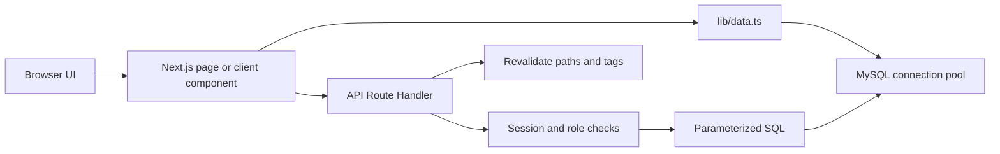
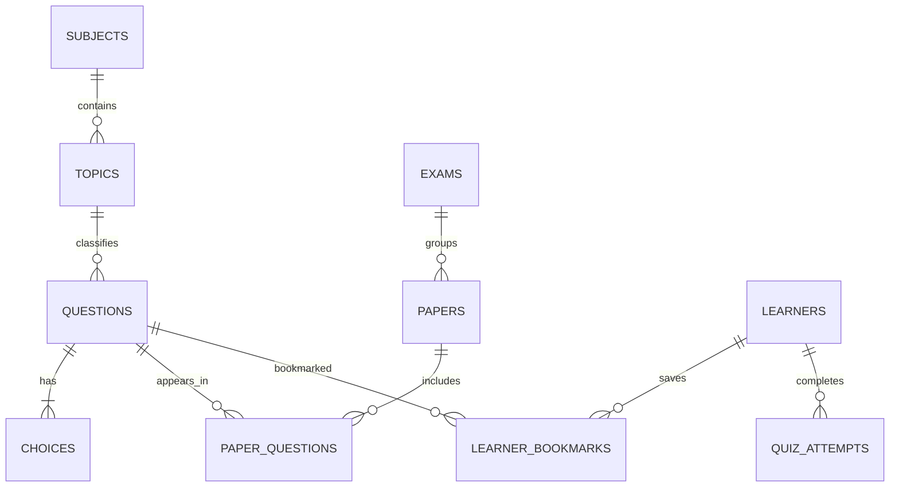

# MCQPath Project Documentation

**Purpose:** Technical overview of the MCQPath website, its user interface, backend routes, MySQL schema, and data flow.
**Stack:** Next.js App Router, React, TypeScript, MySQL (`mysql2`), Tailwind CSS v4, and custom CSS.
**Last updated:** 26 October 2026

## 1. Project overview

MCQPath is a search-friendly MCQ learning and exam-practice website. It has two main experiences:

- **Learner website:** browse subjects and topics, attempt quizzes and verified past papers, search content, save questions, and review quiz progress.
- **Admin workspace:** manage MCQs, categories (subjects and topics), past papers, publishing, and team access according to account permissions.

The website uses server-rendered Next.js pages for public content and API Route Handlers for writes and authenticated actions. MySQL is the source of truth when configured. The `lib/content.ts` demo content is a fallback for public pages when MySQL is unavailable; learner accounts and admin content management require MySQL.

## 2. Technology and code layout

| Area | Technology / location | Responsibility |
|---|---|---|
| Web framework | Next.js App Router 16 | Page routing, server rendering, metadata, cache control, API routes |
| UI | React 19 + TypeScript | Reusable and interactive page components |
| Styling | Tailwind CSS v4 + `app/globals.css` | Global styles, visual tokens, responsive public/admin layouts |
| Database | MySQL 8 / InnoDB + `mysql2` | Persistent questions, papers, users, bookmarks, and quiz attempts |
| SQL connection | `lib/db.ts` | Shared connection pool, environment configuration |
| Read/data layer | `lib/data.ts` | Public content queries, demo fallback, quiz grading, cache tags |
| Admin identity | `lib/admin-auth.ts` | Admin session validation, password hashing, role permissions |
| Learner identity | `lib/learner-auth.ts` | Learner session validation and password hashing |
| API handlers | `app/api/**/route.ts` | Validated admin, learner, bookmark, and quiz actions |
| Database scripts | `sql/migrations/`, `sql/seed.sql` | Schema setup, upgrades, and optional initial data |

```text
app/
  page.tsx                        Home page
  subjects/                       Subject list and detail pages
  topics/                         Topic pages
  quiz/                            Topic quiz page
  past-papers/                     Past-paper list and detail pages
  search/                          Search results
  account/                         Learner account and progress
  admin/                           Admin login and dashboard entry
  api/                             Route Handler endpoints
components/                        Shared UI and client interactions
lib/                                Database, content, and auth helpers
sql/migrations/                     MySQL schema and upgrades
docs/                               Project documentation
```

## 3. Frontend design and page layout

### Public website

The root layout (`app/layout.tsx`) provides the global metadata, header, footer, and global CSS. Public pages use a centered, spacious layout with a warm light background, dark green text, green action colors, and responsive grids. The public content areas generally use a maximum width around 1,360 px; the home hero and admin workspace use wider layouts. On smaller screens, grids collapse and navigation becomes compact.

| URL | Page | Main UI sections |
|---|---|---|
| `/` | Home | Hero and search, site counts, subject cards, popular topics, past-paper cards, calls to action |
| `/subjects` | Subject directory | Breadcrumbs, page introduction, subject cards |
| `/subjects/[slug]` | Subject detail | Breadcrumbs, subject description, topic cards, related past-paper link |
| `/topics/[slug]` | Topic detail | Topic summary, MCQ preview, start-quiz action |
| `/quiz/[slug]` | Topic quiz | Breadcrumbs, quiz information, interactive `QuizRunner` |
| `/past-papers` | Past-paper directory | Verified paper cards and empty state |
| `/past-papers/[slug]` | Past-paper detail | Paper details, quiz runner, related-topic links |
| `/search` | Search | Search box and subject/topic/question results |
| `/account` | Learner account | Sign-in/register, saved questions, quiz attempts, progress |

### Admin workspace

`/admin` is an authentication-gated workspace. It has an Inspinia-inspired vertical admin shell implemented with project CSS: a persistent left navigation on desktop, a top bar, role-specific menu items, and a focused workspace area. On mobile, the sidebar changes into a horizontally scrollable navigation row. The public header and footer are hidden on this route.

| Admin section | Main purpose |
|---|---|
| Overview | Counts, review queue, and shortcuts |
| MCQ bank | Create/edit questions, change category/topic, assign one or more past papers when allowed, publish, or archive according to role |
| Categories | Create/edit subjects and topics, manage publication status |
| Past papers | Create/edit exam papers and build their ordered question lists with the searchable question picker |
| Team & roles | Create/update admin accounts and assign available roles; Super Admin-only |
| Exams | Create and rename exam bodies such as FPSC, PPSC, and NTS for reuse by papers |

The admin interface hides unavailable tools for each role, and the API checks the same permissions independently. The UI should not be treated as the security boundary.

### Visual and accessibility conventions

- Shared colors, focus rings, typography, and responsive behavior are defined in `app/globals.css`.
- Buttons and fields have visible keyboard focus styles.
- Form fields use labels; status messages use alert/status semantics.
- Admin lists and question pickers support search/filtering and pagination where large datasets are expected.
- Admin pages are excluded from indexing. Quiz and search result pages are also configured not to be indexed.

## 4. Backend and request flow

### Read flow

1. A Next.js server page calls a function from `lib/data.ts` (for example, `getSubjects()` or `getPaper(slug)`).
2. The data layer runs parameterized MySQL queries through the shared pool in `lib/db.ts`.
3. Public queries return published content only. When the database is not configured, public read functions use demo objects from `lib/content.ts`.
4. Frequently used content reads use Next.js cache directives and tags such as `subjects`, `topics`, `questions`, and `papers`.
5. Page components render HTML on the server. Interactive parts, such as quizzes and admin editing, are React client components.

### Write flow

1. A client component sends a JSON request to an API Route Handler.
2. The handler authenticates the session, checks role permissions, and validates input.
3. The handler uses parameterized SQL (`?` placeholders) to prevent user-provided values from becoming SQL code.
4. Related writes use a MySQL transaction where atomicity matters (question + options + paper links, or paper + ordered question links).
5. On success, relevant Next.js paths/cache tags are revalidated so public pages do not keep stale published content.



### Quiz answer handling

The public quiz payload is produced with `toPublicQuestion()` in `lib/data.ts`, which omits `correctChoice`. After submission, `/api/quiz/submit` validates the answer list and calls `gradeQuestions()` on the server. Correct answers and explanations are looked up server-side. If a learner is signed in, the handler also records the attempt in `quiz_attempts`.

## 5. MySQL schema and relationships

All primary content tables use InnoDB and `utf8mb4`. IDs are unsigned auto-incrementing integers. Slugs and account emails have unique indexes. Foreign keys protect references; archival is used for content lifecycle instead of routine hard deletion.

### Content tables

| Table | Important columns | Purpose and relationships |
|---|---|---|
| `subjects` | `id`, `name`, `slug`, `description`, `sort_order`, `status`, timestamps | Top-level categories. One subject has many topics. |
| `topics` | `id`, `subject_id`, `name`, `slug`, `description`, `sort_order`, `status`, timestamps | Subcategories. `subject_id` references `subjects.id`; one topic has many questions. |
| `questions` | `id`, `topic_id`, `question_text`, `explanation`, `source_note`, `correct_choice`, `difficulty`, `status`, timestamps | One MCQ belongs to one topic/category and can appear in many past papers. `source_note` is required before publication. |
| `choices` | `id`, `question_id`, `label`, `choice_text` | The answer options for a question, normally labels A–D. `question_id` references `questions.id`; deleting a question cascades to its choices. |
| `exams` | `id`, `name`, `slug` | Normalized exam/commission names. One exam can have many papers. |
| `papers` | `id`, `exam_id`, `title`, `slug`, `year`, `paper_type`, `description`, `status` | A past paper belongs to one exam. Public pages display published papers. |
| `paper_questions` | `paper_id`, `question_id`, `question_order` | Join table for the many-to-many paper/question relationship. Its primary key prevents the same question being linked twice to one paper; `question_order` stores ordering inside that paper. |

### Learner and administration tables

| Table | Important columns | Purpose and relationships |
|---|---|---|
| `admin_users` | `id`, `name`, `email`, `password_hash`, `role`, `status`, timestamps | Staff accounts. Email is unique. Database roles are `super_admin`, `admin`, `data_entry`, `reviewer`, and `publisher`; migration 006 maps legacy `editor` to `data_entry` and legacy Paper Manager `admin` to `publisher`. The bootstrap Super Admin is persisted in this table at first login. |
| `learners` | `id`, `name`, `email`, `password_hash`, `status`, timestamps | Learner accounts. Email is unique. |
| `learner_bookmarks` | `learner_id`, `question_id`, `created_at` | Join table saving questions per learner. Composite primary key prevents duplicate bookmarks. |
| `quiz_attempts` | `id`, `learner_id`, `quiz_title`, `quiz_path`, `score`, `question_count`, `elapsed_seconds`, `completed_at` | Stores a learner's quiz history and score summary. |

### Field formats and constraints

This table summarizes the MySQL storage types and the most important rules from the schema migrations.

| Table | Fields and MySQL formats | Important constraints |
|---|---|---|
| `subjects` | `id BIGINT UNSIGNED`; `name VARCHAR(120)`; `slug VARCHAR(140)`; `description TEXT`; `sort_order INT`; `status ENUM('draft','published','archived')`; `created_at`, `updated_at TIMESTAMP` | `id` is primary key; slug is unique; index on status/order. |
| `topics` | `id BIGINT UNSIGNED`; `subject_id BIGINT UNSIGNED`; `name VARCHAR(160)`; `slug VARCHAR(180)`; `description TEXT`; `sort_order INT`; same status/timestamp format as subjects | Slug is unique; FK to subject; index on parent/status/order. |
| `questions` | `id BIGINT UNSIGNED`; `topic_id BIGINT UNSIGNED`; `question_text TEXT`; `question_image_url VARCHAR(500)` nullable; `explanation TEXT`; `source_note VARCHAR(500)`; `correct_choice CHAR(1)`; `difficulty ENUM('easy','medium','hard')`; workflow/ownership/review fields; timestamps | FK to topic; topic/status index and FULLTEXT question search index. Source note is non-null and defaults to empty text on upgraded installations. |
| `choices` | `id BIGINT UNSIGNED`; `question_id BIGINT UNSIGNED`; `label CHAR(1)`; `choice_text TEXT`; `image_url VARCHAR(500)` nullable | Unique `(question_id, label)`; FK to question with cascade delete. |
| `exams` | `id BIGINT UNSIGNED`; `name VARCHAR(160)`; `slug VARCHAR(180)` | Slug is unique. |
| `papers` | `id BIGINT UNSIGNED`; `exam_id BIGINT UNSIGNED`; `title VARCHAR(220)`; `slug VARCHAR(240)`; `year SMALLINT UNSIGNED`; `paper_type ENUM('Past paper','Model paper','Mock test')`; nullable `shift_session` and `expected_question_count`; `description TEXT`; status and timestamps | Slug is unique; FK to exam; index on exam/year. |
| `paper_questions` | `paper_id BIGINT UNSIGNED`; `question_id BIGINT UNSIGNED`; `question_order INT` | Composite primary key `(paper_id, question_id)`; unique `(paper_id, question_order)`; FKs to paper and question. |
| `admin_users` | `id BIGINT UNSIGNED`; `name VARCHAR(140)`; `email VARCHAR(190)`; `password_hash VARCHAR(180)`; `role ENUM('super_admin','admin','data_entry','reviewer','publisher')`; `status ENUM('active','inactive')`; session/security fields; timestamps | Unique email; index on role/status. Bootstrap `super_admin` is stored in the database after first login. |
| `learners` | `id BIGINT UNSIGNED`; `name VARCHAR(140)`; `email VARCHAR(190)`; `password_hash VARCHAR(180)`; `status ENUM('active','inactive')`; timestamps | Unique email; index on status. |
| `learner_bookmarks` | `learner_id BIGINT UNSIGNED`; `question_id BIGINT UNSIGNED`; `created_at TIMESTAMP` | Composite primary key `(learner_id, question_id)`; both FKs cascade on delete. |
| `quiz_attempts` | `id BIGINT UNSIGNED`; `learner_id BIGINT UNSIGNED`; `quiz_title VARCHAR(220)`; `quiz_path VARCHAR(260)`; `score SMALLINT UNSIGNED`; `question_count SMALLINT UNSIGNED`; `elapsed_seconds INT UNSIGNED`; `completed_at TIMESTAMP` | FK to learner; index on learner/completion date. |
| `learner_action_tokens` | Learner ID, SHA-256 token hash, verification/reset purpose, expiry, used timestamp | Single-use email verification and password reset tokens; cascades with learner deletion. |
| `quiz_attempt_answers` | Attempt, learner, question/topic IDs, selected/correct choices, correctness flag | Stores answer review and supports weak-topic estimates; one row per question per attempt. |
| `api_rate_limit_buckets` | Hashed scope/IP key, window start, hit count | Shared fixed-window counts for sensitive APIs. |

### Relationship diagram



### MCQ and paper data model

The MCQ has a single `topic_id`, so it has one current category/topic. To change category, update `questions.topic_id`; the question's identity and all its paper links remain the same. The paper relationship is separate:

```text
questions.id  ──< paper_questions.question_id >──  papers.id
```

Therefore, one MCQ can be linked to multiple papers without duplicating the question or its options. `paper_questions.question_order` can be different for each paper, so the MCQ can appear at a different position in each exam set.

## 6. Admin roles and content workflow

| Role | Capabilities |
|---|---|
| Data Entry (`data_entry`) | Create MCQs and edit own drafts. |
| Reviewer (`reviewer`) | Review submitted MCQs, edit, approve or reject with a comment. Cannot create papers. |
| Publisher (`publisher`) | Manage papers and publish approved content. |
| Admin (`admin`) | All operational content and team permissions, except Super Admin management and system settings. |
| Super Admin (`super_admin`) | Full access, including publishing, archiving content, and managing team accounts. The bootstrap Super Admin is persisted in `admin_users` on first successful login and must change the initial password. |

The matching permission checks are defined in `lib/admin-auth.ts` and enforced in the API handlers. Content deletion is currently modeled as archiving (`status = 'archived'`) so historical paper links and learner records are preserved.

Typical content workflow:

1. Create a subject, then its topics.
2. Add an MCQ with its category/topic, prompt, four choices, correct option, explanation, difficulty, and source/exam reference.
3. A Publisher or Admin can optionally assign the MCQ to one or several active past papers in the MCQ form. The same MCQ record is reused across papers.
4. Create or edit a past paper and use the question picker to choose, search, filter, and order its MCQs.
5. Submit for review, approve or reject with a comment, then publish approved content. A published question requires a published subject/topic and a source reference. A published past paper must contain published questions.

### Fast MCQ entry workflow

The Questions section uses `components/AdminQuestionWorkspace.tsx`. It keeps the category, paper, difficulty, and editable source note in a sticky context bar while the admin adds questions. The context is stored in browser `localStorage`; the session's recent MCQ IDs and count are stored in `sessionStorage`. Selecting a paper pre-fills the source note and automatically includes that paper on each new question. Choosing no paper creates a question without a paper link.

The fast-entry form contains a question, four choices, one correct-choice radio button, and an optional explanation. `Save & Add Next` (also Ctrl+Enter) creates a draft, clears only those question fields, keeps the context, updates the session list/counter, and focuses the question field. `Save & Close` saves and returns to the MCQ bank. The server validates the required category and source note, four non-empty distinct options, and a correct choice. A same-topic similarity check displays a warning but does not block saving.

The session list provides inline edit, category change, remove-from-paper, publish, and archive actions according to the current role. The bulk-entry tab accepts blank-line-separated questions or CSV, previews validation results, and imports the valid preview rows in one transaction. The MCQ bank supports selection and bulk category, paper, review, publish, and archive actions; each action is permission-checked by its API handler. The schema has no separate review status, so `Submit for review` keeps questions in the existing draft queue.

From the Past Papers section, `Add MCQs to this paper` opens the same fast-entry screen with its paper selected. Paper question ordering supports drag-and-drop and existing up/down controls. Reordering locks the paper's link rows, temporarily assigns negative order values to avoid collisions with the unique `(paper_id, question_order)` index, then writes contiguous positive values in the same transaction.

No table or column changes are required for this workflow. It uses the existing `questions`, `choices`, `papers`, `exams`, and `paper_questions` schema. Question creation plus choice and optional paper-link inserts, bulk imports, category changes, paper link changes, and reordering use transactions where needed. All API inputs remain parameterized, and the server-side role checks remain authoritative.

## 7. API endpoint reference

All endpoints are Next.js Route Handlers under `app/api`. Admin endpoints require a valid admin session and check the relevant permission. Learner-specific endpoints require a learner session.

| Endpoint | Methods | Main purpose |
|---|---|---|
| `/api/admin/login` | `POST` | Verify bootstrap or database admin credentials and issue an HTTP-only session cookie. |
| `/api/admin/logout` | `POST` | Clear the admin session cookie. |
| `/api/admin/questions` | `GET`, `POST`, `PATCH`, `DELETE` | List questions and options; create/update an MCQ and its paper links; publish or archive according to permission. |
| `/api/admin/questions/bulk` | `POST` | Atomically import MCQs or perform permission-checked multi-question category, review, paper-link, publish, and archive actions. |
| `/api/admin/questions/similar` | `POST` | Return likely same-topic duplicate candidates for a non-blocking entry warning. |
| `/api/admin/categories` | `GET`, `POST`, `PATCH` | Read/manage subjects and topics, including status transitions. |
| `/api/admin/exams` | `GET`, `POST`, `PATCH` | List, create, and rename exam names such as FPSC, PPSC, and NTS. |
| `/api/admin/dashboard` | `GET` | Return workflow counts, MCQs per topic, categories without MCQs, and papers below expected question counts. |
| `/api/admin/papers` | `GET`, `POST`, `PATCH`, `DELETE` | Read, create, update, publish, and archive past papers and ordered question links. |
| `/api/admin/papers/quick-create` | `POST` | Create a draft paper inline from its exam, title, and year, then return it for selection in the entry context. |
| `/api/admin/papers/reorder` | `POST` | Validate and transactionally replace the ordered question list for a paper while respecting the unique paper/order constraint. |
| `/api/admin/question-picker` | `GET` | Search/filter/paginate question bank for paper editing; can fetch selected question IDs. |
| `/api/admin/question-images` | `POST` | Upload a validated question or option PNG, JPEG, or WebP image, limited to 5 MB. |
| `/api/admin/export` | `GET` | Download a paper or subject/topic category as CSV or PDF. |
| `/api/admin/users` | `GET`, `POST`, `PATCH` | Manage staff accounts (Super Admin permission). |
| `/api/quiz/submit` | `POST` | Validate answer submissions, grade on the server, return results, and save signed-in attempts. |
| `/api/learner/register` | `POST` | Create a learner and sign them in. |
| `/api/learner/login` | `POST` | Verify credentials and issue learner session. |
| `/api/learner/verify-email` | `POST` | Consume a one-time email verification token. |
| `/api/learner/resend-verification` | `POST` | Send another verification message without revealing whether an account exists. |
| `/api/learner/forgot-password` | `POST` | Request a one-time password reset link. |
| `/api/learner/reset-password` | `POST` | Set a new password and invalidate existing learner sessions. |
| `/api/learner/logout` | `POST` | Clear the learner session. |
| `/api/learner/bookmarks` | `GET`, `POST`, `DELETE` | List, save, and remove a learner's question bookmarks. |
| `/api/learner/progress` | `GET` | Return quiz attempt history and account summary counts. |

## 8. Caching, SEO, and performance

- Public category/topic/question/paper reads use Next.js cache functions in `lib/data.ts` with tags and an hours-scale cache lifetime.
- Admin writes call `revalidateTag()` and, where needed, `revalidatePath()` so public content updates after publication.
- Metadata is defined in `app/layout.tsx` and page-level metadata functions. Dynamic subject, topic, and paper pages provide titles, descriptions, and canonical paths.
- `app/sitemap.ts` builds sitemap URLs from published subjects, topics, and papers. `app/robots.ts` blocks admin, API, and search routes from indexing.
- Quiz pages and search pages set `robots` metadata to avoid indexing low-value or user-specific results.
- Keep database indexes on lookup/status/order columns and use parameterized queries. For very large question banks, prefer the existing paginated question-picker API rather than loading all MCQs into the browser.

## 9. Local environment and database setup

Required environment values are documented in `.env.example`:

| Variable | Meaning |
|---|---|
| `DB_HOST`, `DB_PORT` | MySQL host and port |
| `DB_USER`, `DB_PASSWORD`, `DB_NAME` | Application database credentials and schema name |
| `DB_POOL_SIZE` | Maximum pooled connections |
| `ADMIN_EMAIL`, `ADMIN_PASSWORD` | Bootstrap Super Admin login |
| `SESSION_SECRET` | Long random key used to sign admin and learner sessions |
| `NEXT_PUBLIC_SITE_URL` | Canonical public site origin; use the production HTTPS URL on deployment |
| `RESEND_API_KEY`, `RESEND_FROM` | Email delivery for learner verification and password resets; `RESEND_FROM` must be a verified sender. In development without a key, links are logged to the server console. |

Apply migrations `001` through `007` in the order documented in [MIGRATIONS.md](./MIGRATIONS.md). Migration `004` restores the missing migration number and adds paper metadata. Migration `005` removes old generated practice content and adds source-reference requirements for questions. `sql/seed.sql` is optional starter data; do not treat sample rows as official exam papers.

Common project commands:

```bash
npm install
npm run dev
npm run lint
npm run build
```

## 10. Important implementation rules

1. Keep `correct_choice` out of public quiz props. Grade submissions in the server data layer.
2. Do not build SQL by concatenating user input. Use prepared statements and validate IDs/status values.
3. Use transactions when a single user action writes multiple related rows.
4. Preserve the `paper_questions` relationship when editing an MCQ category; changing `topic_id` must not duplicate or detach the question.
5. Enforce permissions in both the admin UI and the API. API authorization is authoritative.
6. Archive content instead of hard-deleting content that may be referenced by a paper or learner activity.
7. Revalidate cache tags after content updates, especially `subjects`, `topics`, `questions`, and `papers`.
8. Never commit real database passwords, admin passwords, or session secrets. Keep them in local/deployment environment configuration.

## 11. Exam administration and paper metadata

The Admin workspace includes an Exams screen backed by `GET`, `POST`, and `PATCH /api/admin/exams`. Staff with `paper.manage` can create or rename an exam and its slug; API authorization, parameterized SQL, CSRF origin checks, and the admin audit log apply. Papers reference `exams.id`, so renaming an exam updates the label for all related papers without changing their links.

Papers support the types `Past paper`, `Model paper`, and `Mock test`, optional `shift_session`, optional `expected_question_count`, and created/updated timestamps. The expected count is used by the dashboard warning when a paper has fewer linked MCQs than planned. The migration sequence and upgrade notes are in `docs/MIGRATIONS.md`.

## 12. Search, images, dashboard, and exports

Public question search uses MySQL `FULLTEXT` (`MATCH ... AGAINST` in boolean mode) and keeps a parameterized `LIKE` fallback for short terms that MySQL's full-text tokenizer may not index. The question admin checks normalized text in the same topic and reports an exact normalized match separately from fuzzy similarity; both are warnings and do not block saving.

Dashboard metrics come from `/api/admin/dashboard`, so the draft and review counts are not limited to the first page of the MCQ bank. It lists per-topic counts, zero-question topics, and active papers below their optional expected question count. `content:view` is required to load these aggregate metrics.

Question and option image uploads accept PNG, JPEG, and WebP only, verify file signatures rather than trusting the browser MIME type, generate opaque filenames, and reject files larger than 5 MB. SVG is disallowed. Images live under `public/uploads/mcqs`; on a self-hosted Ubuntu deployment, back up this folder and keep it on persistent storage. The content table stores only the generated relative URL. Admin upload requires a question edit/create permission and same-origin request.

The admin export route downloads all non-archived MCQs attached to a paper, subject, or topic as UTF-8 CSV or PDF. Exports contain prompt, category, four options, question/option image URLs, answer, source note, and explanation. Export requires a signed-in content role.

## 13. Learner verification, recovery, and feedback

New learner accounts are pending until they verify their email. Existing learners are marked verified by migration 007 to avoid locking out accounts created before email verification existed. Verification and reset links use random one-time tokens; only SHA-256 token hashes are stored, verification links expire after 24 hours, and reset links expire after one hour. Password reset increments `learners.session_version`, immediately invalidating sessions. To send actual email, configure `RESEND_API_KEY`, `RESEND_FROM`, and `NEXT_PUBLIC_SITE_URL`. Local development without a Resend key writes the action link to the server terminal.

The quiz already showed correct answers and explanations after submission; this update also stores a per-question learner result in `quiz_attempt_answers`. The account progress API uses these rows to suggest topics with at least two answers and below 60% accuracy. Anonymous quiz results still show the review but are not stored for later weakness suggestions.

Rate limits use MySQL fixed-window buckets in `api_rate_limit_buckets` for quiz submissions, learner sign-in, password reset, and verification resend. When MySQL is unavailable, a process-local in-memory fallback is used for local development; production deployments should have MySQL configured so limits are shared by all app processes.
